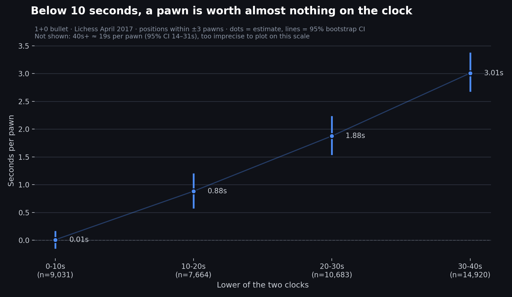
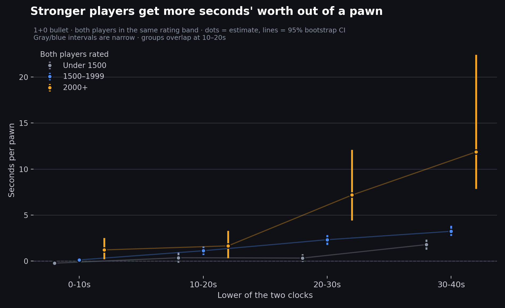
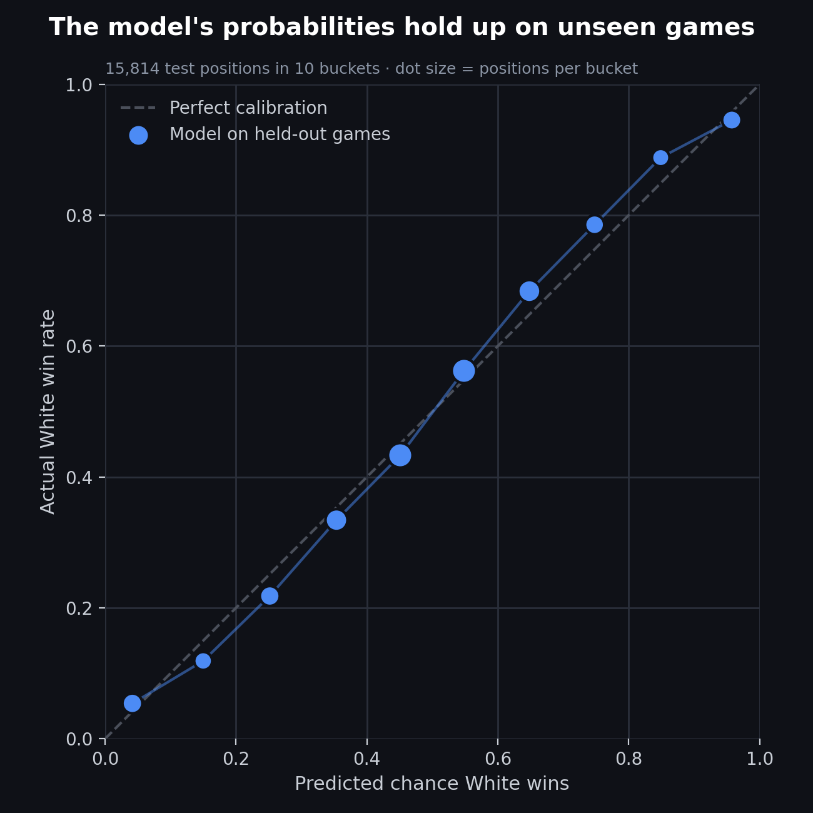

# How Much Is Time Worth in Bullet Chess?

In 1+0 bullet, a pawn is worth more on the clock the more time is left: about 1 second with
10–20 seconds remaining, rising to about 3 seconds with 30–40 seconds remaining. Below 10 seconds,
a pawn's value is statistically indistinguishable from zero, so the clock decides almost everything.
Player strength amplifies this: with 20–40 seconds left, a pawn is worth roughly 7–12 seconds to
2000+ players but under 2 seconds to players rated below 1500.

## Question

In 1+0 bullet chess, how many seconds on the clock is a pawn worth?

Engine evaluations measure who's better on the board, but in bullet the clock often decides the
game. I wanted to estimate the "exchange rate" between material and time: how far ahead on the
clock does a player need to be to make up for being down a pawn? I also wanted to see whether
that rate changes with game phase, how low the clocks are, and player rating.

## My guesses before looking at data

*(Written Oct 23, 2026, before any analysis.)* Based on my own experience playing bullet
(~2100 on Chess.com):

- **Middlegame, up a pawn:** ~5 seconds. At 30s vs. 35s up a pawn, I'd call it roughly equal.
- **Endgame (~15s left), up a pawn:** ~15 seconds. With 15s vs. 30s up a pawn, I'd call it
  equal, though it depends a lot on pawn structure.
- **Middlegame, up a minor piece:** ~20 seconds.

### Something I was unsure about

My gut said time matters more in endgames (being low on time in an endgame feels losing). But my
guesses said the opposite: a pawn is worth 5 seconds in the middlegame and 15 in the endgame,
meaning material gets *more* valuable relative to time. The data should tell me which.

**Answer:** my gut was right. See [Predictions vs. results](#predictions-vs-results).

## Data

- **Source:** Lichess open database, April 2017 (~11.3 million rated games).
- **Games used:** 1+0 games that include both clock times and Stockfish evaluations for each
  move, about 146,000 games. (Most 1+0 games aren't engine-analyzed, so they can't be used.)
- **Sampling:** from each game, one random middlegame position (after move 10) and, if the game
  reached one, one random endgame position (both sides ≤ 10 points of non-pawn material).
  Sampling one or two positions per game keeps long games from dominating the data and avoids
  treating many correlated positions from one game as independent.
- **Filtering:** removed draws (~1%), one game with no recorded result, and 14 positions where a
  clock went above 60 seconds (the opponent added time). Final dataset: **180,027 positions from
  145,027 games.**
- **Close positions:** the main results use positions within ±3 pawns (±300 centipawns), where
  neither side is simply crushing: 63,257 training positions.

## Method

1. **Model.** Logistic regression predicting whether White wins from the engine eval (capped at
   ±10 pawns, forced mates set to ±10), the clock difference (White − Black, in seconds), and the
   rating difference.
2. **Seconds per pawn.** The ratio of the eval and clock weights:
   `100 × (eval weight) ÷ (clock weight)`, i.e. how many seconds of clock advantage push the odds
   of winning as much as one pawn (100 centipawns) does.
3. **Clock levels.** Fit separately in bins of the lower of the two clocks (0–10s, 10–20s, 20–30s,
   30–40s, 40s+), so the exchange rate can change with time pressure. A single model with a
   straight-line interaction produced impossible values (negative seconds per pawn above ~47s),
   so bins were used instead.
4. **Train/test split by game** (80/20), so no game appears in both.
5. **Uncertainty.** 95% confidence intervals from a bootstrap: resampling whole games with
   replacement 500 times and refitting each time.

## Results

### 1. Time pressure collapses the value of material

| Lower clock | Seconds per pawn | 95% CI | Positions |
|---|---|---|---|
| 0–10s | 0.01 | −0.15 to 0.17 | 9,031 |
| 10–20s | 0.88 | 0.57 to 1.21 | 7,664 |
| 20–30s | 1.88 | 1.53 to 2.23 | 10,683 |
| 30–40s | 3.01 | 2.67 to 3.38 | 14,920 |
| 40s+ | 19.3 | 13.8 to 30.6 | 20,959 |

Each step up is statistically distinct (no neighboring intervals overlap). The 40s+ estimate is
large but imprecise: with plenty of time on both clocks, small clock differences barely matter,
so the clock's effect is hard to measure.

### 2. Stronger players get more out of a pawn

With 20–40 seconds left, a pawn is worth about 7–12 seconds to 2000+ players, 2–3 seconds to
1500–1999 players, and under 2 seconds to players below 1500, and these intervals don't overlap.
Below 10 seconds, 2000+ players are the only group for whom a pawn still clearly matters
(~1.2s, CI 0.2–2.5). At 10–20 seconds the groups overlap, so no difference can be claimed there.

### 3. The "endgame effect" is really a clock effect

Endgames first showed a pawn worth only 0.7 seconds vs. 2.5 in middlegames. But low-clock
middlegames showed the same drop (0.5 seconds), so endgames looked different mainly because
they happen when clocks are low.

### 4. The model holds up on unseen games

On the 20% of games held out from training, predicted win probabilities match actual results
within about 4 percentage points in every bucket. The model is slightly underconfident in the
60–90% range.

### Robustness

Changing the "close position" cutoff to ±200 or ±500 centipawns gives the same shape, with
values in the 10–40s bins shifting by roughly 10–15%.

## Predictions vs. results

| Prediction | Result |
|---|---|
| Pawn ≈ 5s in the middlegame | ~3s with 30–40s left, near 0 below 10s |
| Pawn worth *more* seconds in endgames (15s) | ❌ Less: 0.7s, because endgame clocks are low |
| Endgame positions average move 35–45 | ❌ Move 32 (middlegame: move 20) |
| Close-positions-only estimate: 2–2.75s | ✅ 2.37s |
| Adding rating raises the estimate (2.6–3.2s) | ❌ It fell to 2.12s: the eval was partly capturing skill |
| Low-clock middlegames look like endgames | ✅ 0.48s |
| Stronger players value a pawn more | ✅ 7–12s vs. under 2s at 20–40s left |

## Limitations

- **Predictive, not causal.** "Worth 3 seconds" means it predicts winning like 3 seconds does, not
  that gaining 3 seconds would cause a win.
- **Analyzed games only.** Evals exist only when someone requested computer analysis (~8% of
  games), which may not be a random sample.
- **One month of 2017 data.** Today's player pool may behave differently.
- **Whole-second clocks.** Rounding matters most under 10 seconds and likely makes the clock look
  slightly *less* important than it is.
- **Added time** is only detectable when it pushes a clock above 60 seconds.

## How to reproduce

1. Install dependencies: `pip install chess zstandard pandas numpy statsmodels matplotlib`
2. Download `lichess_db_standard_rated_2017-04.pgn.zst` from
   [database.lichess.org](https://database.lichess.org) into this folder.
3. Update the file paths at the top of `extraction.py` and `model.py` for your machine.
4. Run `python extraction.py` (~10 minutes) to build `positions_full.csv`.
5. Run `python model.py` to print the results and save the three charts.